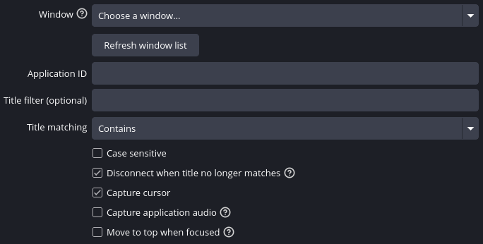

# M4Capture

Capture windows, your desktop, and application audio in OBS Studio on KDE Plasma Wayland. M4Capture remembers your target and reconnects automatically when a window reopens or a display returns.

> [!NOTE]
> **AI disclosure:** This plugin was developed with AI assistance.

## Sources

M4Capture adds three sources to OBS Studio, available under **Sources**:

- **Window Capture (M4Capture)**: Capture an application window, optionally with its audio and cursor, and automatically move the capture above other sources in its OBS scene or group when the window gains focus.

  <p align="center">
    
  </p>

- **Desktop Capture (M4Capture)**: Capture one monitor or all displays together, optionally with the cursor.
- **Application Audio Capture (M4Capture)**: Capture an application's playback without video.

## Requirements

- Linux with **KDE Plasma running a Wayland session**.
- **Native OBS Studio 32 or newer**, using Qt 6.
- **PipeWire 1.2 or newer** for application playback and capture.

The installer supports native OBS. It does not install into Flatpak OBS. HDR capture is not supported.

Compatibility depends on the interfaces provided by your Plasma session; see the [detailed compatibility requirements](docs/development-notes.md#runtime-protocol-requirements).

## Install

Both installation methods build M4Capture from source, so build dependencies must be installed first. On Arch Linux:

```sh
sudo pacman -S --needed base-devel cmake ninja pkgconf obs-studio procps-ng qt6-base pipewire wayland libdrm libglvnd
```

For other distributions, install the equivalent [build dependencies](docs/development-notes.md#build-requirements).

Download or clone this project's source and open a terminal in its directory. Choose one of the methods below.

### Build and install automatically

Close OBS, then run:

```sh
./scripts/install.sh --release
```

Run the installer as your normal user, without sudo. Reopen OBS when it finishes. The three M4Capture sources will be available under **Sources**.

### Build and install manually

To build a folder you can copy into OBS yourself, run:

```sh
./scripts/build.sh --release
```

OBS can stay open while building. The script creates this folder inside the project without installing it into OBS:

```text
build-release/package/m4capture/
├── bin/64bit/m4capture.so
└── data/locale/en-US.ini
```

Close OBS, then copy or move the entire **m4capture** folder into `~/.config/obs-studio/plugins/`. Create the `plugins` folder if it does not exist. If you use `XDG_CONFIG_HOME`, use `$XDG_CONFIG_HOME/obs-studio/plugins/` instead. The resulting library path should be `~/.config/obs-studio/plugins/m4capture/bin/64bit/m4capture.so`.

Copy the whole folder, including `data`, rather than only the `.so` file. Reopen native OBS to use the sources. This folder is not a Flatpak OBS package.

### Update or remove

To update, download or pull the newer source, close OBS, and run the same install command again. For manual installation, rebuild and replace the installed `m4capture` folder while OBS is closed. Reopen OBS to load the update.

To remove M4Capture, close OBS and delete its plugin folder: `~/.config/obs-studio/plugins/m4capture/`. If you use `XDG_CONFIG_HOME`, the folder is under `$XDG_CONFIG_HOME/obs-studio/plugins/m4capture/` instead. If you set a custom install location, remove that folder.

If you previously installed this project under an earlier name, remove that old plugin installation while OBS is closed and recreate its sources with M4Capture. Earlier sources and settings are not migrated automatically.

## Troubleshooting

| Problem | What to check |
| --- | --- |
| M4Capture is missing from the source list | Close and reopen OBS after installation. Check that you are using native OBS 32+ and installed the plugin as the same user who runs OBS. |
| A window capture stays transparent | Open the target application, refresh the window list, and check the application ID and title filter. If several windows match, select one or narrow the filter. |
| A desktop capture stays transparent | Check that the selected monitor is connected, then refresh the display list. |
| Application audio is silent | Keep a matching window open and play sound through PipeWire. For Window Capture, enable **Capture application audio**. Check the source's volume and mute setting in OBS. |
| Audio sounds doubled | Disable other OBS sources recording the same application or desktop playback. |
| A CPU fallback warning appears | Capture can continue with higher CPU usage. Restart OBS or recreate the source to retry GPU capture. |

Capture runs while the source is visible in OBS, including previews and projectors. It resumes automatically when shown again.

For more detail about a problem, open the current OBS log and look for `[M4Capture]` messages.

## Development

See the [development notes](docs/development-notes.md) for build options, tests, benchmarks, and implementation details.

## License

M4Capture is licensed under the GNU General Public License, version 3 or (at your option) any later version (`GPL-3.0-or-later`). See [LICENSE](LICENSE) for the full text.

The bundled Wayland protocol files retain their upstream licenses; see [protocols/README.md](protocols/README.md).
